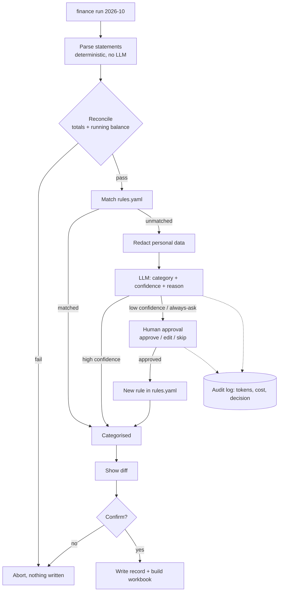

# ethan-agents

Personal AI agents built as testable software, not prompts.
Design principle: **the LLM only does the parts that need judgment. Everything else is code that can be tested.**

| Agent | Status |
|---|---|
| `finance_agent`: bank + card statements → reconciled, categorised monthly record | 🚧 v1 in progress (BOC card + HSBC bank) |
| `news_agent`: daily finance + tech digest → Notion | ⏳ planned |

## finance_agent



### Guardrails
- **The LLM never touches amounts.** Parsing and reconciliation are deterministic and must tie out to the statement before anything is written.
- **Closed category list.** The model picks from an enum via a forced tool call; it cannot invent a category.
- **Human-in-the-loop** for low-confidence items and always-ask items (FPS to a person, ATM cash).
- **Learning from approvals.** Every approved answer becomes a rule, so the same merchant never costs an LLM call twice.
- **Redaction** of card, account and phone numbers before any model call.
- **Audit log** of every model call and human decision, with token cost.

### Metrics (filled in from real monthly runs)
| Month | Items | Rules | LLM | Human | LLM-needed rate | LLM cost |
|---|---|---|---|---|---|---|
| | | | | | | |

### Privacy model
This repo contains code and **synthetic** fixtures only. Real statements, `finance_data.json`,
`rules.yaml` and the audit log live in `FINANCE_DATA_DIR`, outside the repo, and are git-ignored.

## Quickstart
```bash
uv sync --extra dev
uv run pytest
cp .env.example .env   # set ANTHROPIC_API_KEY and FINANCE_DATA_DIR
uv run finance run 2026-10 --dry-run
```

## How it was built
With Claude Code, through branches and pull requests, CI on every PR. See [docs/ai-dev-log.md](docs/ai-dev-log.md).
